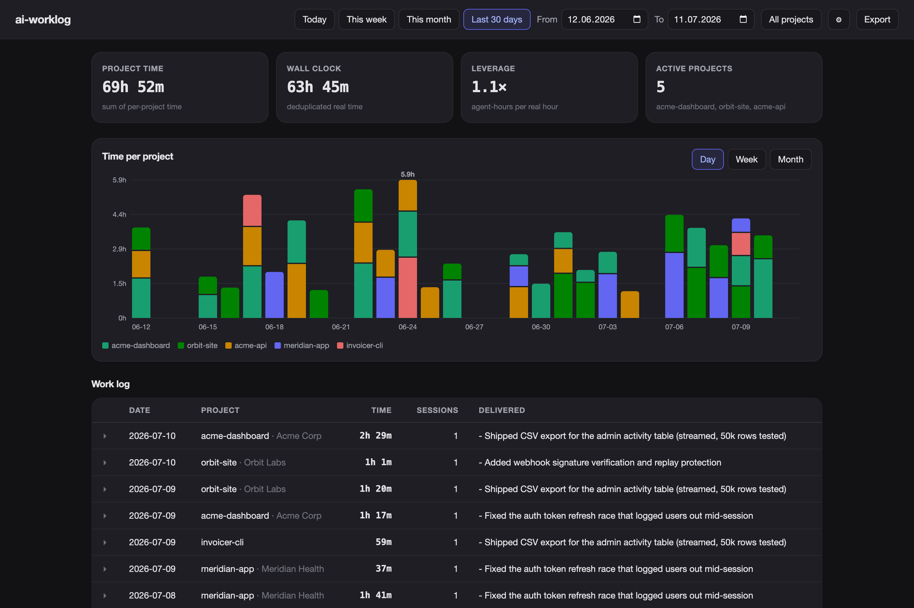

# ai-worklog

ai-worklog turns the session data of your AI coding assistants into a dashboard of hours and deliverables.

[Claude Code](https://claude.com/claude-code) and [opencode](https://opencode.ai) write detailed session data to disk while you work. ai-worklog reads it: the time of every message and tool call, the session titles, and the git commits that you made during each session. From these facts it shows where your hours went, per project and per client. You start no timers, and you fill in no forms after the fact.

ai-worklog has no dependencies, by design: PHP 8.2, SQLite, and plain JavaScript, CSS and SVG. It uses no Composer, no npm and no CDN. Everything runs and stays on your machine.



## Run it

You need:

- PHP 8.2 or later with `pdo_sqlite`. Both come with `brew install php`.
- macOS or Linux, where Claude Code or opencode write their data.
- At least one data source: Claude Code sessions in `~/.claude/projects`, or the opencode database at `~/.local/share/opencode/opencode.db` (ai-worklog opens it read-only).
- Optional: [Ollama](https://ollama.com) with `qwen3:14b`, for the daily deliverable bullets. Everything else works without it.

Get the code:

```sh
git clone https://github.com/vladootz/ai-worklog.git && cd ai-worklog
```

Then run it in one of two ways.

### A. Laravel Herd at https://worklog.test

1. Put the repo in a directory that [Herd](https://herd.laravel.com) parks, for example `~/Sites/worklog`.
2. Isolate the site to PHP 8.2 or later, for example with `herd isolate 8.5`.
3. Open https://worklog.test.

You do not need `serve.sh`. `LocalValetDriver.php` sets the web root to `public/`, so the web server never serves `ai-worklog.db`, `lib/` or `ingest.php`. The dashboard keeps its data fresh by itself (see [How the dashboard stays fresh](#how-the-dashboard-stays-fresh)).

### B. bin/worklog at http://localhost:8111

```sh
bin/worklog
```

`bin/worklog` ingests your session data, serves the dashboard at http://localhost:8111 and opens it in your browser. Then it ingests again every 5 minutes, until you press Ctrl-C.

## Commands

Each command prints the text in this section when you give it `-h` or `--help`. If a command gets an option or a word that it does not know, it prints `unknown option: <arg>` and its usage line. Then it exits with code 2. If an option has no value, it prints `missing value for --<option>` and exits with code 2. In both cases, the command stops before it reads, writes or starts anything.

### php ingest.php

<!-- help: php ingest.php --help -->
```
usage: php ingest.php [option]...

Reads Claude Code and opencode sessions, git commits and presence.log into
ai-worklog.db. Then a local Ollama model writes the deliverable digests for the
last 30 days. With no option, one run does both.

  --skip-digests               read the data, write no digests
  --digests-only               write the digests, read no data
  --digest-days N              write digests for the last N days (default 30)
  --digest-from YYYY-MM-DD     write digests from this day on, not the last N days
  --digest-to YYYY-MM-DD       write digests up to this day (default today)
  --recoalesce                 rebuild all blocks from the stored events, then exit
  --zone YYYY-MM-DD=Area/City  you were there from that local midnight on, then exit
  --zones                      print the travel log, then exit
  -h, --help                   print this help, then exit

You can give --zone more than once.
```
<!-- /help -->

If the model times out on a day, the run prints `N FAILED`. Those days get a new try on the next pass. A backfill of months of history with `--digest-from` and `--digest-to` takes a while.

### bin/worklog

<!-- help: bin/worklog --help -->
```
usage: bin/worklog [--skip-digests] [--digest-days N]

Ingests, serves the dashboard at http://localhost:8111 and opens it in your
browser. Then it ingests again every 5 minutes. If a server already answers on
that port, it uses that server. Ctrl-C stops the loop, and the server if
bin/worklog started it.

  --skip-digests    pass --skip-digests to every ingest (no Ollama digests)
  --digest-days N   pass --digest-days N to every ingest
  -h, --help        print this help, then exit

For a one-time run (--digests-only, --digest-from, --digest-to, --recoalesce,
--zone, --zones), use php ingest.php.
```
<!-- /help -->

### serve.sh

<!-- help: ./serve.sh --help -->
```
usage: [PORT=N] ./serve.sh

Serves the dashboard at http://localhost:8111 until you press Ctrl-C. It does
not ingest, except once when ai-worklog.db does not exist yet (without digests).
If a server already answers on the port, it says so and exits.

  PORT=N       serve on port N instead of 8111
  -h, --help   print this help, then exit

To ingest again every 5 minutes while the dashboard is open, use bin/worklog.
```
<!-- /help -->

To run the parts by hand, run `php ingest.php`, then serve the dashboard with `php -S localhost:8111 -t public public/index.php`.

### bin/presence

<!-- help: bin/presence --help -->
```
usage: bin/presence sample | install | uninstall | status

Records your keyboard and mouse idle time once a minute in presence.log, so
ingest can tell "away from the Mac" from "working outside the agent". The
samples stay on this Mac.

  sample       append "<epoch> <idle_seconds> <zone>" to presence.log (launchd runs this)
  install      load a LaunchAgent that samples every 60 s, also after login
  uninstall    unload and remove the LaunchAgent (presence.log is kept)
  status       show whether it is loaded and the newest samples
  -h, --help   print this help, then exit
```
<!-- /help -->

[Presence sampler](#presence-sampler-optional) tells what the samples change.

### bin/timester-replace

<!-- help: bin/timester-replace --help -->
```
usage: bin/timester-replace <timester-backup.json> [--to YYYY-MM-DD] [--out PATH]

Rebuilds a timester backup so that its ai-worklog entries, their projects and
clients match worklog now (after renames, client changes, ignored projects).
It reads the backup and never changes it. It writes a new file, by default
timester-replace-<date>_<time>.json next to the backup. Import that file in
timester with the option that replaces all data.

  <timester-backup.json>  a backup exported from timester, not an ai-worklog export
  --to YYYY-MM-DD         last day to rebuild (default yesterday)
  --out PATH              write the new file here
  -h, --help              print this help, then exit
```
<!-- /help -->

[Fallback: rebuild a timester backup](#fallback-rebuild-a-timester-backup) gives the steps.

## What the dashboard shows

- Your time per project needs no timer. Ingest rebuilds work blocks (stretches of continuous work) from the event times of each session, so you switch nothing on.
- Parallel agent sessions count in full for each project, but only once in your wall-clock total. Your leverage is the ratio between the two.
- Your deliverables come from facts. Ingest stores the git commits and diff stats of each session window. A local Ollama model turns them into 2–4 bullets per project per day.
- Each directory becomes a project by itself. On the `/settings` page you can merge, rename, assign clients or ignore projects.
- Hand-made SVG charts show stacked bars per project, by day, week or month, with date presets and project filters.
- The "Projects worked on" panel sits next to the leverage figure. It lists the projects and hours of the past week, month, 3 months, 6 months, year and 2 years. Each row opens to the full list, with clients.
- The billing export holds your whole history as one entry per work block. Each entry has real start and end times and the time zone where you worked. Timester takes it in one sync step.
- Each rule (gap threshold, deduplication, rounding) is simple enough to defend on an invoice.

## How time is computed

Ingest reads the time of every message and tool event from the Claude Code JSONL files (subagents included) and from the opencode database. It keeps each event in the `events` table, with a flag on the prompts that you typed.

Events less than 15 minutes apart merge into one work block. Each block stores the threshold that made it, so past numbers never change silently. A block with one event counts as 60 seconds. Without presence data, agent run time counts as work, also when you are away.

With the presence sampler on (see the next section), your keyboard and mouse input shapes the blocks:

- A gap of 15 to 60 minutes counts when your Mac recorded input during the whole gap. For example, you test the site in a browser between two prompts.
- Time with no input for more than 5 minutes does not count, also when an agent still works. The first 5 minutes of each idle stretch still count, because reading is work.
- Gap time does not count while another project had activity, because your attention was there.
- Where there are no samples (before you installed the sampler, or while the Mac was asleep), the plain 15-minute rule applies.

`php ingest.php --recoalesce` rebuilds all blocks from the stored events with the current rule. Past numbers change only when you run it.

Ingest stores the blocks per session, and they are the ground truth. ai-worklog computes the per-project totals and the wall-clock total from them each time it shows them, as interval unions (overlapping time counts once). As a result, parallel agent sessions count in full for each project, and never twice in the wall-clock total. Leverage is project time divided by wall-clock time.

A moment belongs to the calendar day where you were at that moment. Ingest records your time zone as you travel, so a past day never moves when you export it from another country. Around a flight, a day can be shorter or longer than 24 hours, like a daylight-saving day.

## Presence sampler (optional)

The sampler records how many seconds passed since your last keyboard or mouse input, once a minute. A launchd agent runs it, so it also works when the dashboard is closed. Each line of `presence.log` holds the Unix time, the idle seconds and the time zone of the Mac. The file stays on your Mac.

To start the sampler, run `bin/presence install`. [bin/presence](#binpresence) lists the other subcommands.

The next ingest reads the new lines of `presence.log`. Sessions after the install use the presence rule. Older sessions keep the plain 15-minute rule.

## Travelling

ai-worklog keeps a travel log: the time zone that you were in, and from when. The presence sampler notes the zone of your Mac every minute, and every ingest notes it too. For this, your Mac must set its time zone automatically (System Settings → General → Date & Time).

```sh
php ingest.php --zones                              # show the travel log
php ingest.php --zone 2026-07-15=Europe/Bucharest   # you were in Bucharest from 15 July, 00:00 local time
```

You can give `--zone` more than once. Use it to add trips from before you installed the sampler, or to correct a wrong entry.

## Deliverables

Ingest stores the facts first: the git commits made during each session window, the session titles and the diff stats. Then a local Ollama model (`qwen3:14b` by default) writes 2–4 deliverable bullets per project per day. ai-worklog caches each digest by a hash (a fingerprint) of its inputs.

To get a new digest for a day, open the day detail and click **Regenerate now** (**Generate now** when the day has no digest yet). A row with nothing else to show has a **Generate digest** button that does the same. The button marks the day stale and starts the digest pass in the background at once.

The digest input is only prompts, titles, commit messages and diff stats, never full transcripts. Only `ingest.php` calls Ollama, never a web request. If Ollama does not run, ingest skips the digests.

The digest window is 30 days, the same as the default range of the dashboard. As a result, every day that the dashboard shows by default can have a digest.

## Projects and mappings

Every directory becomes a project by itself. The project takes the last part of the directory path as its name and shows an "unmapped" badge. To change the mappings, click the gear icon (**Project mappings**) to open the `/settings` page. There you can:

- Rename a project. Give several directories the same project name to merge them into one project.
- Assign a client.
- Ignore throwaway directories.

Ignored projects disappear from all views and exports.

## Export to timester

The **Export** button downloads your whole tracked history, whatever range the dashboard shows. Each work block becomes one time entry, with its real start and end time and the time zone where you worked. The digest of that day is its description. The file uses the schema of timester (the billing tool of the author) and carries a `source: "ai-worklog"` marker. It is plain JSON, so you can adapt it to your own tool.

To bring it into timester:

1. In ai-worklog, click **Export**, then **Download JSON**.
2. In timester, click **Import** and select the file. Timester selects **Sync from ai-worklog** by itself.
3. Read the preview, then click **Sync**.

The sync replaces every entry with the `ai-worklog` tag, and it never changes the entries that you made in timester. Renamed projects, client changes and ignored projects follow by themselves.

Do not import this file with **Merge**. Timester refuses it, because a merge adds a second copy of every entry.

### Fallback: rebuild a timester backup

Use `bin/timester-replace` only with a timester version that has no **Sync from ai-worklog** import. The command applies the same rules to a backup file:

1. In `/settings`, rename, merge, ignore or assign clients until the dashboard is correct.
2. In timester, export a backup.
3. Run `bin/timester-replace` with that backup:

   ```sh
   bin/timester-replace ~/Downloads/timester-export-2026-10-10_09-00.json
   ```

4. Read the report. It lists the entries that change, the projects that it creates or removes, and the client changes.
5. In timester, import the file that the command wrote, with the import that replaces all data.

The command replaces every `ai-worklog` entry with a fresh export up to yesterday, in the same format as the **Export** button. It copies all your other entries unchanged, and it makes sure of this before it writes. A project in timester is a name under a client, so the command matches on both. It never changes the client of a project that holds your own entries, and it never deletes a client. If you edit an `ai-worklog` entry by hand in timester, the next rebuild overwrites that edit.

## Configuration

The defaults are in [`lib/Config.php`](lib/Config.php). They are the port (8111), the gap threshold (15 minutes), the presence idle time (5 minutes) and the longest presence gap (60 minutes). They are also the Ollama URL and model, the digest window and the source paths. Change them there. On purpose, there is no configuration file format to learn.

## How the dashboard stays fresh

Under Herd, nothing runs the 5-minute ingest loop of `bin/worklog`, because Herd only serves the dashboard. For this reason, the dashboard keeps its data fresh from the browser:

- When you open it and the last ingest is more than 5 minutes old, it ingests again.
- The **Read data** button in the header ingests again at once.

The web layer never ingests in its own process. It starts the command-line `ingest.php` instead, so the CLI-only guard of `ingest.php` still holds. `Config::phpCli()` finds a PHP 8.2 or later binary for this, and the `WORKLOG_PHP` environment variable overrides it.

The time figures refresh while you wait (`--skip-digests`, about 8 seconds). The Ollama digests run in a background pass and appear a moment later. You can still run `php ingest.php` or `bin/worklog` from the command line.

## Request safety

The app has no accounts, but under Herd it answers on a real hostname. For this reason, it makes sure that every request that changes state (`POST /api/*`) comes from the same origin, before the router runs:

- `Sec-Fetch-Site` must be `same-origin` when the browser sends it.
- `Origin`, when present, must match the host.
- A request with neither header comes from a caller that is not a browser (curl, `bin/worklog`), and the app allows it.

This rule stops another site in your browser from changing your project mappings or starting ingests. It is not authentication.

Do not expose this app beyond localhost without real authentication.

## Your data

Everything is local. Your sessions, projects, clients and digests live in `ai-worklog.db` in the repo root, and git ignores that file. There is no telemetry, and no network call except to Ollama on your own localhost.

To share the app itself without your data:

```sh
./archive.sh         # → dist/ai-worklog-YYYY-MM-DD.zip
```

The archive holds only the files that git tracks. It refuses to build if anything like a database gets in. Git ignores `presence.log` too, and the archive refuses it in the same way.

Claude Code deletes transcripts after `cleanupPeriodDays`. You can raise this value in `~/.claude/settings.json`. The author of this repo uses 365.

From the moment ai-worklog ingests a session, `ai-worklog.db` is your permanent archive. Ingest is idempotent (safe to run again): a second run never counts anything twice. The database also keeps the raw event times, so `--recoalesce` can rebuild the blocks after Claude Code deleted the transcripts.

## Design notes

[PLAN.md](PLAN.md) has every decision and its reason: the time model, the treatment of overlaps, the schema, and why there are no packages.

## License

[MIT](LICENSE)
